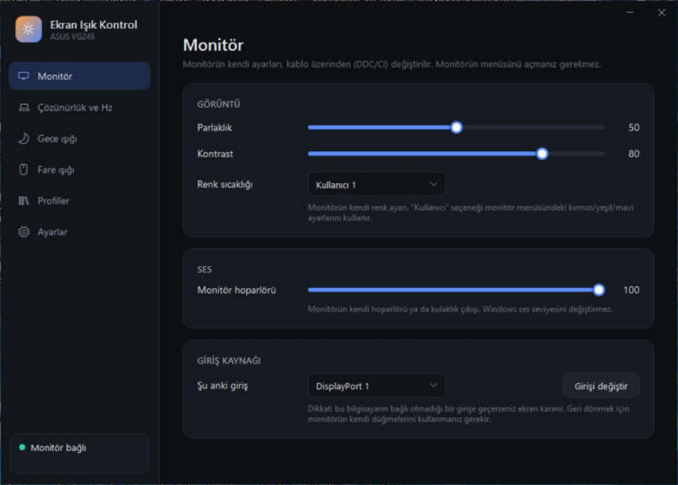

# Ekran Işık Kontrol

> ⬇️ **İndir:** [Windows (ZIP)](https://github.com/avsessisozx/EkranIsikKontrol/releases/latest/download/EkranIsikKontrol.zip)

Masaüstü monitörün parlaklığını telefondaki gibi tek kaydırıcıyla ayarlayan, Windows ekran ayarlarını,
gece ışığını ve fare ışığını tek pencerede toplayan, hafif ve Türkçe bir Windows programı.

- Kurulum gerektirmez, Windows 10/11'de hazır gelen .NET Framework 4.8 ile çalışır
- Yönetici izni gerekmez
- Telemetri, hesap, internet bağlantısı yok

## Kullanım

1. [Releases](../../releases) sayfasından `EkranIsikKontrol.zip` dosyasını indirip bir klasöre çıkarın.
2. `EkranIsikKontrol.exe`'yi çalıştırın. İmzasız olduğu için SmartScreen uyarı verebilir: **Ek bilgi → Yine de çalıştır**.
3. Saatin yanında güneş simgesi çıkar. **Tıklayınca** hızlı panel, **çift tıklayınca** tam pencere açılır.
   Simge gizli simgeler (^) arasındaysa onu görev çubuğuna sürükleyebilirsiniz.
4. İsterseniz Ayarlar sayfasından "Windows açılınca başlat"ı açın.

## Özellikler

**Monitör (DDC/CI ile, kablo üzerinden)**
- Parlaklık, kontrast, monitörün kendi renk sıcaklığı ön ayarları, hoparlör sesi, giriş kaynağı (HDMI/DisplayPort)
- Seçenekler monitörün kendi bildirdiği yeteneklere göre gösterilir
- Kaydırıcı hızlı oynatılınca yalnızca son değer gönderilir; monitör takılıp çıkarılınca yeniden taranır

**Windows ekran ayarları**
- Çözünürlük ve yenileme hızı. Değişiklikten sonra 15 saniye içinde "Kalsın" denmezse eski ayara dönülür.

**Gece ışığı**
- Windows'un kendi gece ışığını açma/kapatma ve sıcaklığını (1200K–6500K) ayarlama.
  Windows'ta resmi bir arayüzü olmadığı için kayıt defterindeki ayar değeri kullanılır.

**Fare ışığı (SteelSeries Rival 3)**
- Renk ve parlaklık. Arka planda, pencere açmadan [OpenRGB](https://openrgb.org) sunucusu çalıştırılır.
- OpenRGB'nin kendi ayar klasörü kullanılır ve yalnızca fare dedektörü açık bırakılır: klavyeye, anakarta ve RAM'e dokunulmaz.
- OpenRGB programla birlikte gelmez. [openrgb.org](https://openrgb.org/releases.html) adresinden "Portable (.zip)"
  sürümünü indirip `EkranIsikKontrol.exe`'nin yanında `OpenRGB` klasörüne çıkarın ya da Ayarlar'dan `OpenRGB.exe`'yi seçin.
- SteelSeries GG açıksa fare rengini kendi ayarına geri çevirebilir; GG'de farenin aydınlatmasını kapatın.

**Profiller**
- Gündüz / Gece / Oyun hazır gelir. Şu anki ayarları yeni profil olarak kaydedebilir, güncelleyebilir, silebilirsiniz.

**Sorun bildirme**
- Ayarlar → "Hata raporunu kopyala": monitör, ekran, gece ışığı, fare bilgisi ve son günlük satırları panoya kopyalanır.
- Ayarlar ve günlük: `%APPDATA%\EkranIsikKontrol`

## Bilinen sınırlar

- DDC/CI monitörün menüsünde kapalıysa ya da monitör bazı USB/dock adaptörleriyle bağlıysa parlaklık değiştirilemez.
- Kasa fanlarının ışığı kasanın kendi kontrol kutusuna bağlıysa hiçbir program onu değiştiremez.
- Klavye bu programda yoktur; Corsair K55 için [K55 Kontrol](https://github.com/avsessisozx/K55Kontrol) kullanılır.

## Derleme

Visual Studio 2022 derleme araçları (MSBuild) gerekir. `derle.cmd` birim testlerini derleyip çalıştırır, sonra uygulamayı
`bin\EkranIsikKontrol.exe` olarak derler. `bin\DonanimTesti.exe` gerçek monitörde okuma/yazma denemesi yapar ve her değişikliği geri alır.

## Teşekkür

- Gece ışığı kayıt biçiminin çözümlemesi [sem-reg](https://crates.io/crates/sem-reg) (MIT/Apache-2.0) kütüphanesine dayanır.
- Fare ışığı [OpenRGB](https://openrgb.org) SDK protokolünü kullanır.

> Bu proje ASUS, SteelSeries, OpenRGB ya da Microsoft ile bağlantılı değildir. Adlar yalnızca uyumlu donanımı belirtmek için kullanılır.
